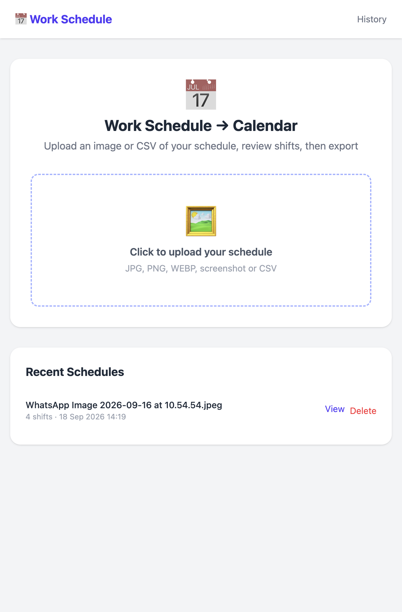
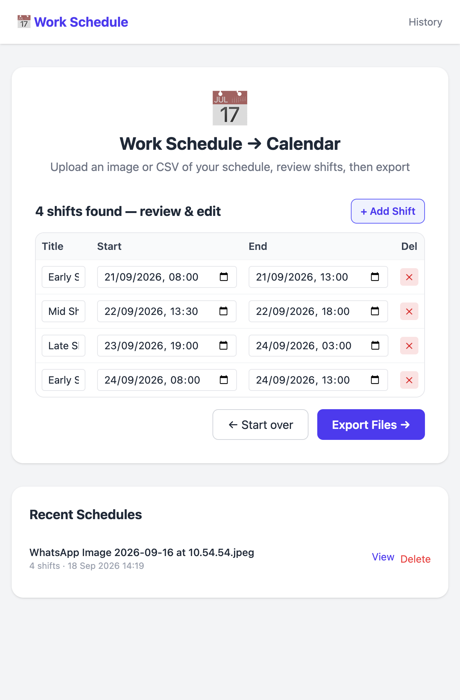
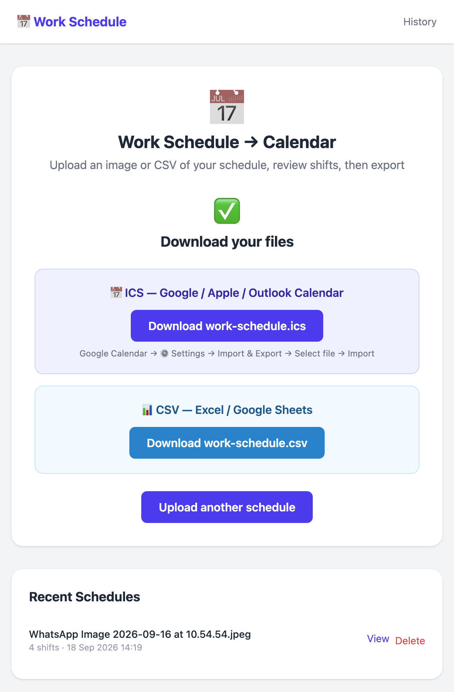

# Work Scheduler

Turn a photo or CSV of your work roster into calendar files. Upload a screenshot, review the extracted shifts, then download an ICS file for Google / Apple / Outlook or a CSV for Sheets.

Built with Rails 7.2, Tailwind, and Claude (`claude-sonnet-4-6`) for image analysis.

## Screenshots

### Upload

Drop a JPG, PNG, WEBP, or CSV. Recent uploads stay listed at the bottom so you can reopen or delete them.



### Review

Claude extracts shift times from the image. Edit titles and datetimes, add missing rows, or delete extras before you export.



### Export

Download `work-schedule.ics` for calendar apps or `work-schedule.csv` for spreadsheets.



## How it works

1. **Image upload** — the file is sent to Claude, which returns a JSON array of `{ title, start, end }` shifts.
2. **CSV upload** — Outlook-style columns (`Subject`, `Start Date`, `Start Time`, `End Date`, `End Time`) are parsed locally. No API call.
3. **Titles** — end times are mapped to Early Shift (08:00–12:00), Mid Shift (12:01–16:00), or Late Shift (20:00–04:00).
4. **Export** — ICS and CSV are generated from the (possibly edited) shift list.

## Requirements

- Ruby 3.1.2
- PostgreSQL
- An [Anthropic API key](https://console.anthropic.com/settings/keys) (needed only for image analysis)

## Setup

```bash
git clone (https://github.com/shclarke007/work-calendar-schedule)
cd work-scheduler
bin/setup
```

Create a `.env` in the project root (this file is gitignored):

```
ANTHROPIC_API_KEY=sk-ant-your-key
```

Start the app (Puma):

```bash
rails server
```

Open [http://localhost:3000](http://localhost:3000).

If you already have a server running, `bin/rails server` on port 3000 is enough; restart it after changing `.env` so the key is loaded.


* Services (job queues, cache servers, search engines, etc.)

## Stack

| Piece | Choice |
| --- | --- |
| App | Rails 7.2 |
| DB | PostgreSQL (`jsonb` shift lists) |
| CSS | Tailwind |
| Vision | Anthropic Claude via `ruby-anthropic` |
| Config | `dotenv-rails` (`.env`) |
